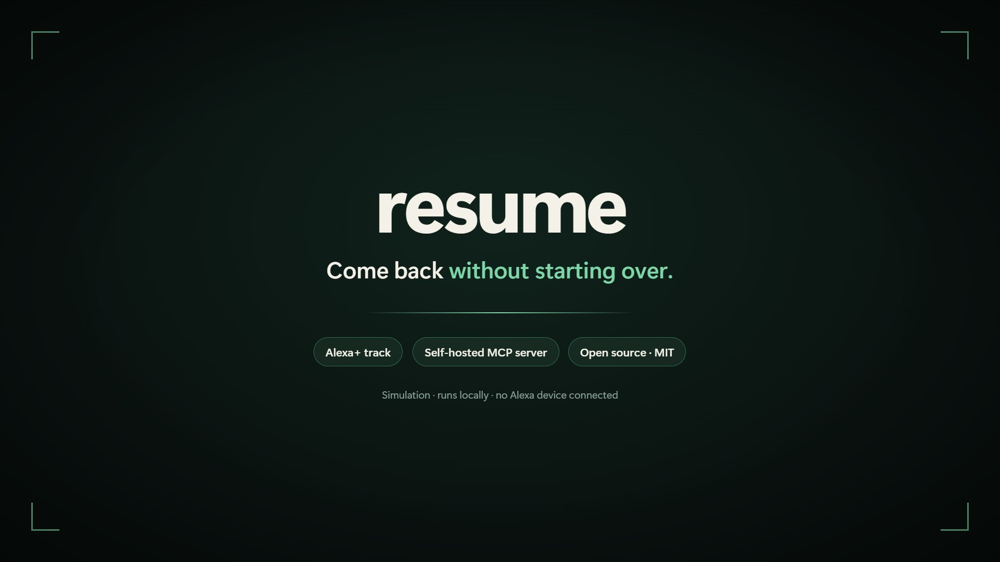
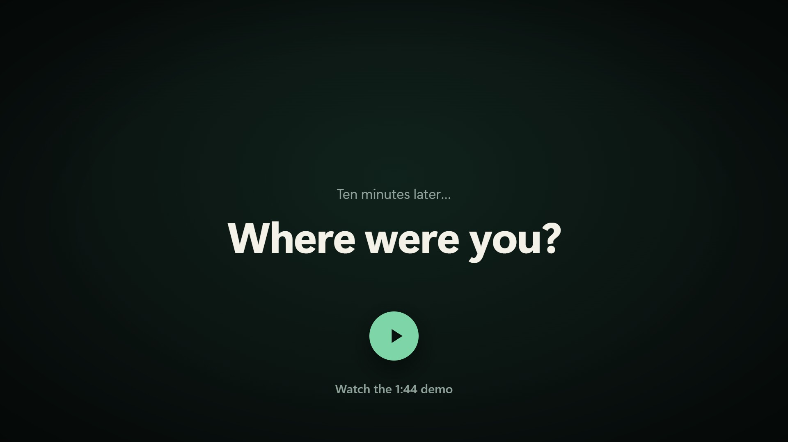
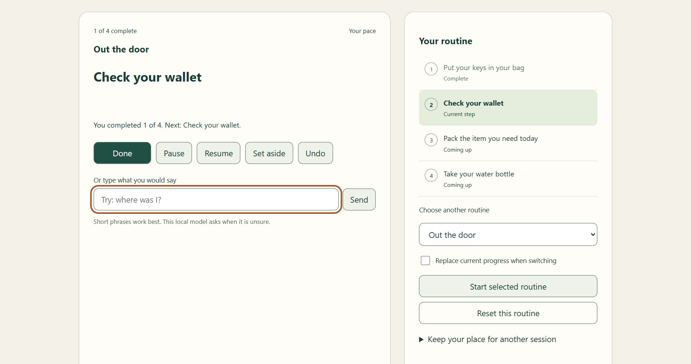
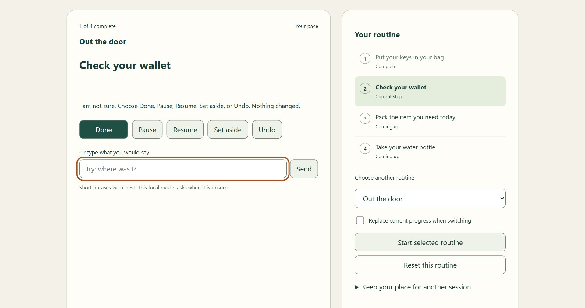
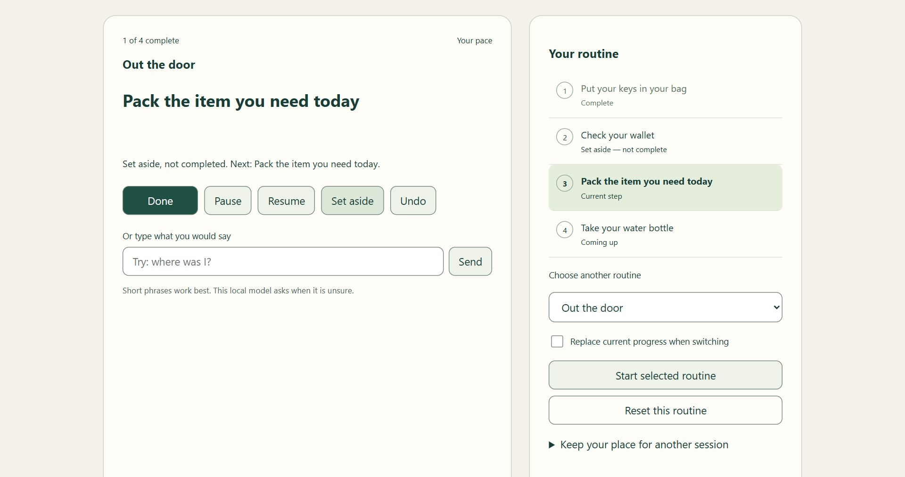
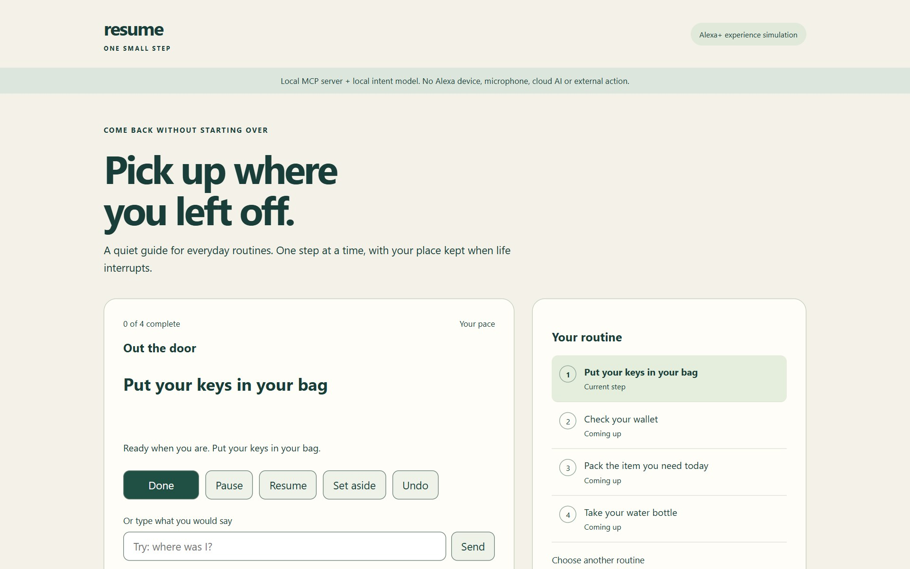
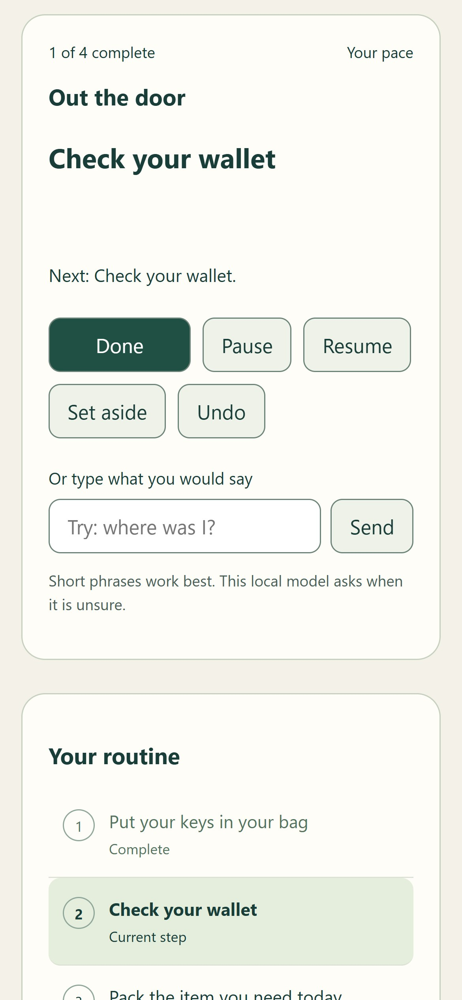
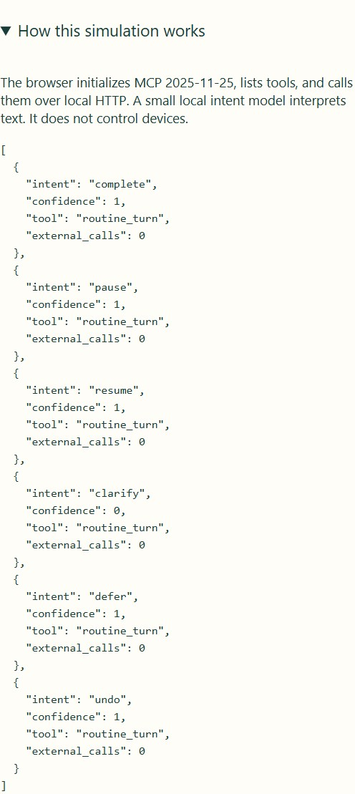
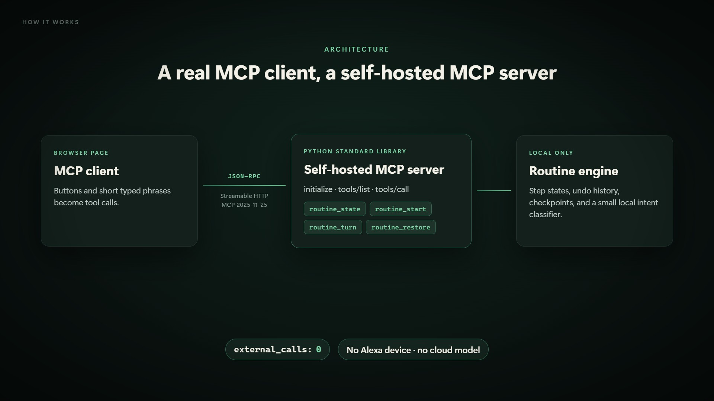

<p align="center">
  
</p>

<h1 align="center">Resume</h1>

<p align="center">
  <b>Come back to an everyday routine without starting over.</b><br>
  An Alexa+ experience built on a self-hosted <a href="https://modelcontextprotocol.io">Model Context Protocol</a> server.
</p>

<p align="center">
  <a href="https://www.youtube.com/watch?v=uP-_tGptZLw"></a>
  
  
  
  
  
  
  <a href="LICENSE"></a>
</p>

<p align="center">
  <a href="#-demo">Demo</a> ·
  <a href="#-quick-start">Quick start</a> ·
  <a href="#-how-it-works">How it works</a> ·
  <a href="#-mcp-tools">MCP tools</a> ·
  <a href="#-testing">Testing</a>
</p>

---

Resume guides a short routine one step at a time and keeps your place when life interrupts. Pause, ask **"where was I?"**, set a step aside without pretending it's done, undo a mistake, and carry your progress in a checkpoint file you own.

Built for the **Build, Ship, Shape: Amazon Developer Hackathon**, Alexa+ track.

> [!NOTE]
> Resume is a simulated Alexa+ experience: a web page acts as a real MCP client for a self-hosted MCP server. It runs entirely on your machine. No Alexa device, speech service or cloud model is connected, and no data leaves the computer.

## 🎬 Demo

<p align="center">
  <a href="https://www.youtube.com/watch?v=uP-_tGptZLw">
    
  </a>
  <br>
  <sub>1:44 · animated walkthrough plus the real app, recorded locally · <a href="https://www.youtube.com/watch?v=uP-_tGptZLw">Watch on YouTube</a></sub>
</p>

## 💡 Why

An interruption — a phone call, a knock at the door — can break a routine's flow and make the next step unclear. Most checklists either restart from the top or quietly lose your place. Resume keeps every step's state visible and makes recovery reversible, so getting back on track takes one question instead of starting over.

## ✨ Features

<table>
  <tr>
    <td width="50%" valign="top">
      
      <p><b>Pause, then ask "where was I?"</b><br>Pausing keeps your exact place. One question brings you back to the next step.</p>
    </td>
    <td width="50%" valign="top">
      
      <p><b>Asks instead of guessing</b><br>When a phrase is unclear, including negations like "not done", it asks, and nothing changes.</p>
    </td>
  </tr>
  <tr>
    <td width="50%" valign="top">
      
      <p><b>Set aside is never "done"</b><br>Deferred steps are tracked separately and come back when you resume. Undo reverses any change.</p>
    </td>
    <td width="50%" valign="top">
      
      <p><b>One next step, full routine alongside</b><br>Three sample routines: Out the door, Start a focused session, Close the workday.</p>
    </td>
  </tr>
</table>

- **Portable checkpoints.** Download your progress as a small JSON file and restore it in a fresh session, with explicit confirmation.
- **Undo that you can trust.** Any change can be reversed, and actions that change nothing never use up an undo.
- **Accessible basics.** Keyboard operable with visible focus, a skip link, live status announcements, and a responsive layout down to phone width.

<p align="center">
  
  &nbsp;&nbsp;&nbsp;
  
  <br>
  <sub>Phone layout · the built-in trace: every turn is an MCP tool call with <code>external_calls: 0</code></sub>
</p>

## 🚀 Quick start

Requires **Python 3.10 or newer**. Nothing else to install.

```bash
git clone https://github.com/Appvertices/alexa-resume.git
cd alexa-resume
python3 server.py
```

On Windows, use `python server.py` (or `py server.py`) if `python3` is not found.

Open **http://127.0.0.1:8011** in a browser. Press Ctrl+C to stop the server. To use another port, run `python3 server.py --port 8123`.

### Try it

1. Press **Done** to complete the first step.
2. Press **Pause**, then type `where was I?` and press Enter.
3. Type `not done`: the app asks instead of guessing, and nothing changes.
4. Press **Set aside**, then **Undo**.
5. Open **Keep your place for another session** and download a checkpoint. Restart the server, reload the page, then restore the checkpoint (tick the confirmation box first).

Phrases it understands include `done`, `pause`, `stop`, `where was I?`, `I'm back`, `what's next?`, `skip`, `later`, `undo`, `go back`, and `start over`.

## 🌐 Deploy a live demo

Resume runs on any host that can start a Python process. [Render](https://render.com)'s free tier works with no build step and no packages to install.

**Render (one click):** [Deploy to Render](https://render.com/deploy?repo=https://github.com/Appvertices/alexa-resume) uses the included [`render.yaml`](render.yaml). Or create a **Web Service** from this repository with:

| Setting | Value |
|---|---|
| Runtime | Python 3 |
| Build command | `echo "No build step"` |
| Start command | `python server.py --host 0.0.0.0` |
| Instance type | Free |

Render provides `PORT` and `RENDER_EXTERNAL_HOSTNAME`, and the server picks both up automatically. It then accepts only that hostname over HTTPS, plus localhost. On another host, set `PUBLIC_HOST` to your domain, or pass `--public-host your.domain`. Free instances sleep when idle, so the first visit can take up to a minute to wake.

## 🧭 How it works

<p align="center">
  
</p>

The page runs the full MCP lifecycle: `initialize`, `notifications/initialized`, `tools/list`, then a `tools/call` for every button press or typed phrase. Each call returns the complete routine state, and the trace panel ("How this simulation works") shows every turn with `"external_calls": 0`.

## 🛠 MCP tools

| Tool | Arguments | What it does |
|---|---|---|
| `routine_state` | — | Read the current routine and progress (read-only). |
| `routine_start` | `routine_id`, `version`, `confirmed?` | Start a bundled routine. Replacing existing progress requires `confirmed: true`. |
| `routine_turn` | `text` (≤ 400 chars), `version` | Interpret a short typed turn: complete, pause, resume, set aside, undo, status or reset. |
| `routine_restore` | `checkpoint`, `version`, `confirmed` | Restore a checkpoint file after explicit confirmation. |

Every state-changing call carries the `version` it was based on, so a stale or duplicated request is rejected instead of being applied twice.

### Transport details

- **Endpoint:** `POST /mcp` with JSON responses. `GET /mcp` returns 405 (no server-initiated stream); `DELETE /mcp` ends a session.
- **Sessions:** issued on `initialize` through the `MCP-Session-Id` header. They are kept in memory and expire after one hour of inactivity.
- **Protocol version:** negotiated at `initialize`. An `MCP-Protocol-Version` header, when sent, must match `2025-11-25`, and mismatches are rejected before any state changes.
- **Local-only by default:** the server binds to `127.0.0.1` and rejects requests whose `Host` or `Origin` is not loopback. A hosted demo can allow exactly one extra public hostname over HTTPS (see [Deploy a live demo](#-deploy-a-live-demo)). It sends security headers, including a strict Content-Security-Policy.

### Connect your own MCP client

Any MCP client that speaks Streamable HTTP can use the server at `http://127.0.0.1:8011/mcp`. With the official Python SDK (`pip install mcp`):

```python
import asyncio, json
from mcp import ClientSession
from mcp.client.streamable_http import streamable_http_client

async def main():
    async with streamable_http_client("http://127.0.0.1:8011/mcp") as streams:
        async with ClientSession(*streams[:2]) as session:
            await session.initialize()
            tools = await session.list_tools()
            print("tools:", [t.name for t in tools.tools])
            state = json.loads((await session.call_tool("routine_state", {})).content[0].text)
            reply = await session.call_tool("routine_turn", {"text": "done", "version": state["version"]})
            print(json.loads(reply.content[0].text)["message"])  # Next: Check your wallet.

asyncio.run(main())
```

## ✅ Testing

```bash
python3 -m unittest discover -s tests -v    # 52 tests: routine rules, HTTP security, MCP wire protocol
node --check static/app.js                  # JavaScript syntax
python3 verify_local.py                     # everything above, plus client-logic checks and a static accessibility audit
```

`verify_local.py` needs Node.js for the client-logic checks and writes its results to `evidence/`.

**Official MCP SDK interoperability.** `tests/check_official_sdk.py` drives the server with the official MCP Python SDK: initialize, tools/list, ping, tool calls, error codes, session isolation and checkpoint restore across two clients. Install the SDK in a separate virtual environment, so the app itself stays dependency-free:

```bash
python3 -m venv .venv-sdk
.venv-sdk/bin/pip install mcp            # Windows: .venv-sdk\Scripts\pip install mcp
.venv-sdk/bin/python tests/check_official_sdk.py
```

Latest result: **PASS** with `mcp` 2.3.0 (see `evidence/official-sdk-check.txt`). Exit code 77 means the SDK is not installed (BLOCKED), not a failure.

## 📁 Project structure

```
server.py          HTTP transport: MCP endpoint, sessions, static files, security headers
domain.py          Routine engine, MCP JSON-RPC handling and tool schemas
adapters.py        Small local intent classifier for short typed phrases
static/            Web client: MCP client logic, UI and styles
tests/             Unit, HTTP, MCP wire-protocol and regression tests; SDK and client checks
verify_local.py    One-command verification; writes results to evidence/
render.yaml        Render Blueprint for a free hosted demo
evidence/          Latest verification output
docs/images/       Screenshots and diagrams used in this README
```

## ⚠️ Limitations

- This is a prototype, not a production service. State lives in memory and is cleared when the server restarts, unless you export a checkpoint.
- The intent classifier is intentionally small. It handles short phrases from a fixed vocabulary, not open conversation. The buttons always work.
- It is a typed web simulation: no voice input, no Alexa device and no cross-device sync.
- The server is a small standard-library HTTP server, fine for local use and a low-traffic demo, not a production service. A hosted demo keeps all sessions in one process's memory, so a restart clears them.
- There has been no user study, and no measured-outcome claims are made.

## 📄 License

[MIT](LICENSE)
